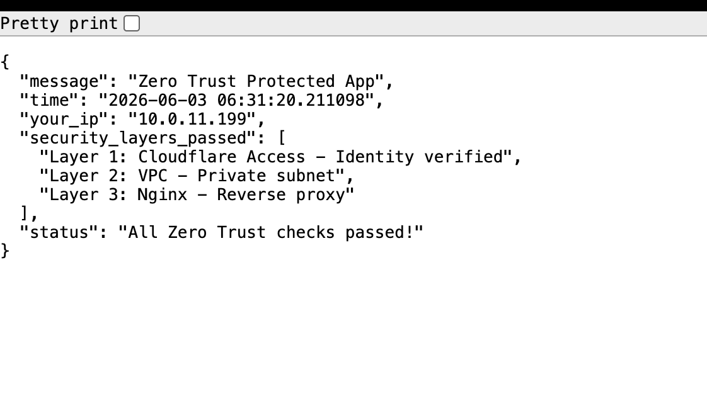

# Zero Trust Network Architecture on AWS + Cloudflare
 
> **No public IP. No open ports. No implicit trust.**  
> A production-grade Zero Trust network built on AWS VPC and Cloudflare Tunnel — where the app server is completely invisible to the internet.
 
---

The app server has **no public IP** and sits in a **private subnet**. The only way in is through all security layers.
 
---
 
## Architecture
 
```
User (Internet)
      │
      ▼
┌─────────────────────┐
│  Cloudflare Access  │  ← Layer 1: Identity verification (Zero Trust gateway)
│  (trycloudflare.com)│
└────────┬────────────┘
         │  Encrypted Tunnel (QUIC/HTTP2)
         ▼
┌─────────────────────────────────────────────────────┐
│                   AWS VPC (10.0.0.0/16)             │
│                                                     │
│  ┌──────────────────────────────────────────────┐   │
│  │         Public Subnet (10.0.0.0/20)          │   │
│  │                                              │   │
│  │   ┌──────────────────────┐                   │   │
│  │   │   zt-nginx-proxy      │  ← Layer 3: Reverse proxy + security headers
│  │   │   (t3.micro)          │                  │   │
│  │   │   IP: 3.239.38.251    │                  │   │
│  │   └──────────┬───────────┘                   │   │
│  └──────────────┼───────────────────────────────┘   │
│                 │  Internal traffic only            │
│  ┌──────────────┼───────────────────────────────┐   │
│  │         Private Subnet (10.0.128.0/20)       │   │
│  │                                              │   │
│  │   ┌──────────▼───────────┐                   │   │
│  │   │   zt-app-server       │  ← Layer 2: No public IP, no direct access
│  │   │   (t3.micro)          │                  │   │
│  │   │   IP: 10.0.11.199     │                  │   │
│  │   └──────────────────────┘                   │   │
│  └──────────────────────────────────────────────┘   │
│                                                     │
│  Network Connections: IGW (public) + NAT Gateway    │
└─────────────────────────────────────────────────────┘
```
 
---
 
## Security Layers
 
| Layer | Component | Role | What it blocks |
|-------|-----------|------|----------------|
| **1** | Cloudflare Access | Identity verification, Zero Trust gateway | Unauthenticated users, bots, direct IP access |
| **2** | AWS VPC Private Subnet | Network segmentation | Any traffic not routed through Nginx |
| **3** | Nginx Reverse Proxy | Request forwarding, security headers | Malformed requests, exposes only `/` |
| **4** | No Public IP on App Server | App server invisible to internet | Direct attack surface completely eliminated |

---
 
## Stack
 
- **Cloud**: AWS (VPC, EC2, NAT Gateway, Internet Gateway)
- **Zero Trust Gateway**: Cloudflare Tunnel (cloudflared)
- **Reverse Proxy**: Nginx
- **App Server**: Python (HTTP)
- **OS**: Ubuntu 24 LTS
---
 
## Key Concepts
 
### Zero Trust
"Never trust, always verify." Every request is authenticated — even internal ones. Network location means nothing; identity and context are everything.
 
### Defense in Depth
No single layer is relied upon. If Cloudflare Access were bypassed, the attacker still hits a VPC boundary. If they breach the VPC boundary, there's no public IP to target the app server directly.
 
### Private Subnet + NAT
The app server can initiate outbound connections (via NAT Gateway) but receives **zero inbound connections from the internet**. It's not just firewalled — it's architecturally unreachable.
 
### Cloudflare Tunnel vs. Exposing Ports
Traditional approach: open port 443, configure TLS, expose public IP.  
This approach: cloudflared on the server creates an **outbound** encrypted tunnel to Cloudflare's edge. No inbound ports opened. No IP exposed.
 
---

## 📸 Dashboard Screenshots
 
### Layer 1 — Cloudflare Tunnel Connected (QUIC)

 
### Layer 2 — VPC Resource Map

 
### Layer 3 — EC2 Instances (Nginx + App Server)

 
### Result — All Zero Trust Checks Passed

---
 
